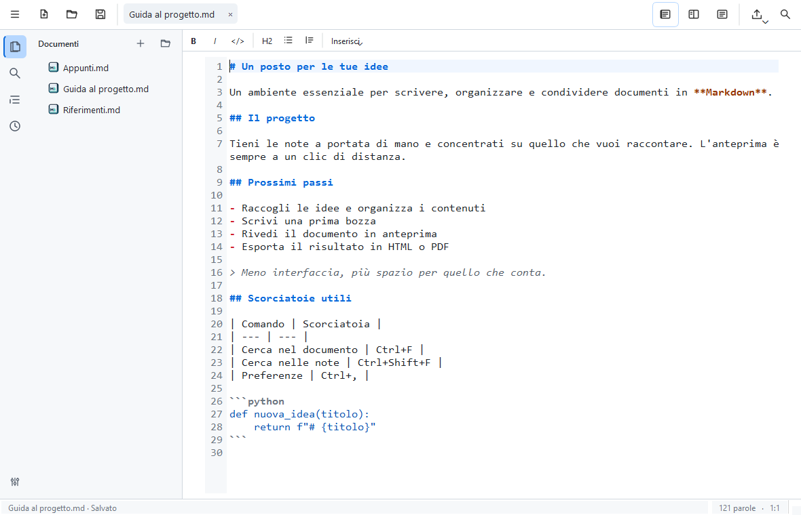
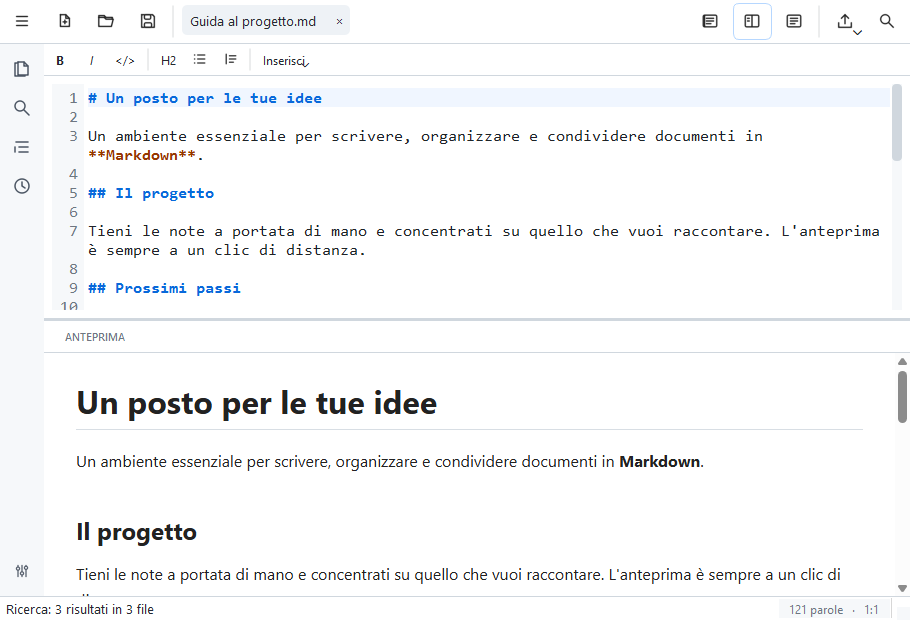
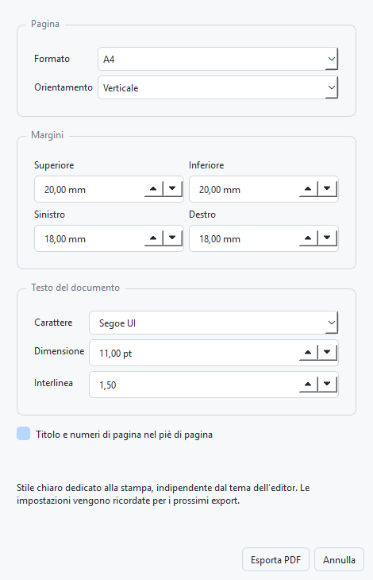
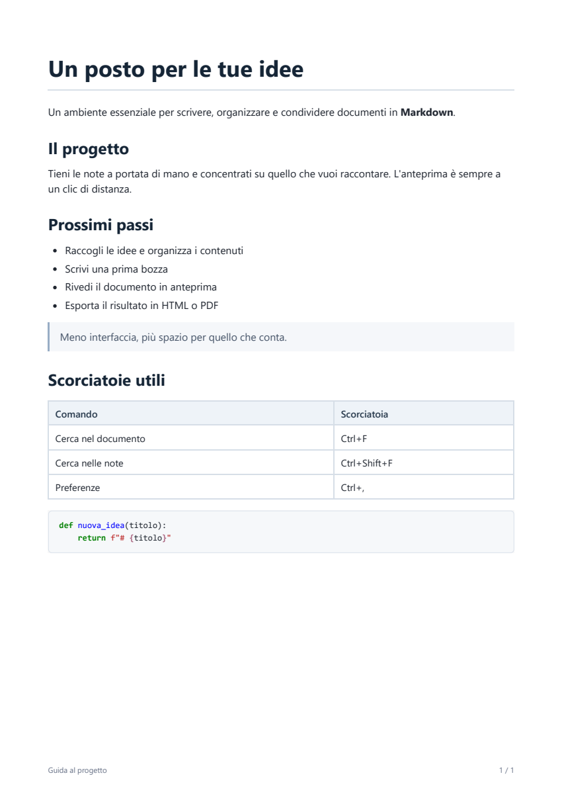
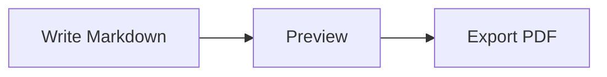

<div align="center">


<h1>Markdown Studio</h1>

<p><strong>A focused desktop workspace for Markdown.</strong></p>

<p>Write in a clean editor, preview as you go, and export carefully formatted documents.</p>

<p>
  <a href="CHANGELOG.md"></a>
  <a href="#getting-started"></a>
  <a href="requirements.txt"></a>
  <a href="LICENSE"></a>
</p>

<p>
  <a href="https://github.com/GiancaGIS/MarkDownViewer/releases"><strong>Download releases</strong></a>
  &nbsp;&middot;&nbsp;
  <a href="#getting-started">Get started</a>
  &nbsp;&middot;&nbsp;
  <a href="#pdf-export">PDF export</a>
  &nbsp;&middot;&nbsp;
  <a href="CHANGELOG.md">Changelog</a>
  &nbsp;&middot;&nbsp;
  <a href="https://github.com/GiancaGIS/MarkDownViewer/issues">Report an issue</a>
</p>

</div>

---

Markdown Studio is a desktop Markdown editor built with **Python and PyQt6**. A compact command bar, document tabs, and an optional workspace sidebar leave room for your writing. Switch between a readable writing column, live preview, and an adaptive split layout without losing your place.

> **Development preview · 1.1.0**<br>
> The features and screenshots below describe the current source version. Published installers may contain an earlier version; check the [release notes](https://github.com/GiancaGIS/MarkDownViewer/releases) and [changelog](CHANGELOG.md).

<p align="center">
  
  <br>
  <sub>Writing mode keeps the document at the center of the workspace.</sub>
</p>

<p align="center">
  <a href="#features">Features</a> &nbsp;·&nbsp;
  <a href="#your-workspace">Your workspace</a> &nbsp;·&nbsp;
  <a href="#images-and-diagrams">Images &amp; diagrams</a> &nbsp;·&nbsp;
  <a href="#keyboard-shortcuts">Shortcuts</a> &nbsp;·&nbsp;
  <a href="#development">Development</a>
</p>

## Features

| Focus | What you get |
| :--- | :--- |
| **Focused writing** | Multiple document tabs, a centered writing column, line numbers, Markdown highlighting, and quick formatting tools. |
| **Live preview** | Writing, Split, and Reading modes, synchronized scrolling, Mermaid diagrams, and external links that open in your browser. |
| **An organized workspace** | A file tree, recent documents, folder search, and a heading outline, accessible from a narrow navigation rail. |
| **An adaptable interface** | A collapsible sidebar, vertically stacked editor and preview on smaller windows, light/dark themes, and Italian/English UI. |
| **Documents ready to share** | HTML export and dedicated PDF typography, paper settings, margins, and optional page numbering. |
| **Everyday conveniences** | Independent autosave for saved tabs, atomic saves, persistent preferences, image drag and drop, and GitHub update notifications. |

<details>
<summary><strong>See the compact layout</strong></summary>

The sidebar collapses automatically on smaller windows. Split mode stacks the editor and preview when horizontal space is limited, and remembers horizontal and vertical proportions independently.



</details>

## Getting started

### Windows installer

Download the installer attached to a [published GitHub Release](https://github.com/GiancaGIS/MarkDownViewer/releases). Setup supports installation for the current user or all users, with optional Markdown file associations.

To try the features currently in development, run the source version instead.

### Run from source

Install **Python 3.10+**, then clone or download this repository. From the project directory, run:

**Windows**

```powershell
.\run_windows.bat
```

**Linux / macOS**

```bash
bash run_linux_mac.sh
```

The launcher creates a local `.venv`, installs the dependencies, and starts the app. The first run requires internet access to download packages. Linux/macOS execution also depends on Qt WebEngine support on the host system.

<details>
<summary><strong>Manual installation</strong></summary>

Dependencies are listed in [requirements.txt](requirements.txt): PyQt6, PyQt6-WebEngine, Markdown, and Pygments.

**Windows PowerShell**

```powershell
py -3 -m venv .venv
.\.venv\Scripts\python.exe -m pip install -r requirements.txt
.\.venv\Scripts\python.exe src/app.py
```

**Linux / macOS**

```bash
python3 -m venv .venv
.venv/bin/python -m pip install -r requirements.txt
.venv/bin/python src/app.py
```

</details>

## Your workspace

### Write, preview, read

Use the view buttons in the header, or **Menu → View**, to choose a layout:

| Mode | Best for | Shortcut |
| :--- | :--- | :--- |
| **Writing** | A centered source editor with formatting tools. The default for a fresh installation. | `Ctrl+Alt+1` |
| **Split** | Editing alongside a live preview, side by side or vertically stacked. | `Ctrl+Alt+2` |
| **Reading** | A preview that gives the document more space while keeping tabs accessible. | `Ctrl+Alt+3` |

Hover a header icon to see its label and shortcut. Press **F10** to open the full application menu.

In Split mode, synchronized scrolling follows source blocks in both directions, including wrapped editor lines, lists, tables, and code. Scroll either panel with the mouse, keyboard, or scrollbar; the other follows without moving the text cursor or selection. Alignment refreshes after images load or the layout changes. Toggle it with **Ctrl+Alt+P**.

### Organize your notes

1. Select **Open folder** in the empty sidebar, or choose **Menu → Workspace → Open workspace folder**.
2. Open documents from **Files**, then switch between them using tabs.
3. Search the workspace with **Ctrl+Shift+F** and double-click a result to jump to its line.
4. Use **Outline** to navigate headings, or **Recent** to reopen a document.

Click the selected rail icon again to close the sidebar. The file panel also supports creating, renaming, and deleting notes. Workspace search supports `.md`, `.markdown`, `.mdown`, `.mkd`, and `.txt`, with an optional case-sensitive match.

Each tab keeps its own file path and modified state. Opening an already open file selects its tab. Closing a modified tab prompts you to save, discard, or cancel.

### Make it comfortable

Open **Preferences** from the navigation rail or press **Ctrl+,** to set editor and preview fonts, text size, line spacing, reading width, theme, language, wrapping, autosave, and startup update checks. Preferences persist across launches. PDF layout has its own settings in the export dialog.

Use **Ctrl+F** for document search, **Enter/F3** for the next match, **Shift+F3** for the previous match, and **Esc** to close search.

Saved documents have independent autosave timers, including tabs in the background. Unsaved documents require a first manual save. Atomic writes replace the previous file only after the complete save succeeds.

## PDF export

Choose **Export PDF** from the header's export menu, or press **Ctrl+Shift+P**. Configure the print layout before choosing the destination file:

| Setting | Available options |
| :--- | :--- |
| **Paper** | A4 or Letter, portrait or landscape. |
| **Margins** | Independent top, bottom, left, and right margins in millimeters. |
| **Typography** | Document font, size in points, and line spacing. |
| **Footer** | Optional document title and current/total page numbers on supported WebEngine versions. |

Settings are remembered for your next export. A **dedicated light print style** keeps the PDF independent of the editor theme, preview zoom, and window size. Text remains selectable, headings stay with following content, table headers repeat across pages, and long code lines wrap. Code blocks can continue across pages, while images are constrained to the printable area. Landscape orientation gives wider tables more room.

<details>
<summary><strong>See the export settings and a sample PDF page</strong></summary>

<table>
  <tr>
    <th>Print settings</th>
    <th>Exported page</th>
  </tr>
  <tr>
    <td valign="top"></td>
    <td valign="top"></td>
  </tr>
</table>

</details>

To force a page break, insert this on its own line, with blank lines around it:

```html
<div class="page-break"></div>
```

Export captures a snapshot of the selected document, so changing tabs while it runs does not change the output. It waits for fonts, images, and diagrams before printing, with a 30-second timeout. Missing images or failed diagrams produce an error; a failed export preserves an existing destination PDF.

Page numbering requires Chromium 131 or newer, which supports [CSS page margin boxes](https://developer.chrome.com/blog/print-margins). The checkbox is disabled on older Qt WebEngine versions.

**Need HTML instead?** Choose **Export HTML** or press **Ctrl+Shift+H**. HTML uses your preview typography and theme.

## Images and diagrams

Drag `.png`, `.jpg`, `.jpeg`, `.gif`, `.webp`, or `.svg` images into the editor. The app copies them to an `assets/` folder beside the document and inserts a relative reference:

```md

```

If the document is unsaved, the app asks you to save it first.

For diagrams, use a fenced `mermaid` block:

````md

````

Mermaid renders in the live preview, HTML export, and PDF export. It loads from jsDelivr only when diagrams are present, so rendering requires internet access. Once exported, the PDF contains the rendered diagram and can be read offline.

## Update notifications

Starting with 1.1.0, the app checks for a newer stable GitHub Release shortly after launch. An **in-app toast** offers a link to its release page, where you can download the installer. The check runs asynchronously; offline connections and API failures do not interrupt startup.

Use **Help → Check for updates** for a manual check. Automatic checks can be disabled in Preferences. **Help → Releases on GitHub** always opens the release list.

Open **Help → About** to see the application version, author, and copyright.

<details>
<summary>How release detection works</summary>

The checker uses GitHub's [latest release API](https://docs.github.com/en/rest/releases/releases#get-the-latest-release), excludes drafts and prereleases, compares numeric versions, and has a ten-second timeout. Tags should use a numeric version such as `1.1.1` or `v1.1.1`.

A version must be published as a GitHub Release for the app to detect it. Pushing commits, creating a bare tag, or changing the source version does not publish an update. The app links to the release; it does not install updates automatically.

</details>

## Keyboard shortcuts

| Action | Shortcut |
| :--- | :--- |
| New / open / save document | `Ctrl+N` / `Ctrl+O` / `Ctrl+S` |
| Save as | `Ctrl+Shift+S` |
| Writing / Split / Reading | `Ctrl+Alt+1` / `Ctrl+Alt+2` / `Ctrl+Alt+3` |
| Find in document | `Ctrl+F` |
| Next / previous match | `F3` / `Shift+F3` |
| Search workspace | `Ctrl+Shift+F` |
| Show/hide sidebar | `Ctrl+Alt+S` |
| Preferences | `Ctrl+,` |
| Export HTML / PDF | `Ctrl+Shift+H` / `Ctrl+Shift+P` |

<details>
<summary><strong>More navigation and formatting shortcuts</strong></summary>

| Action | Shortcut |
| :--- | :--- |
| Application menu | `F10` |
| New workspace note | `Ctrl+Shift+N` |
| Open workspace folder | `Ctrl+Shift+O` |
| Rename workspace file | `F2` |
| Delete workspace file | `Delete` |
| Close document search | `Esc` |
| Sync preview scroll | `Ctrl+Alt+P` |
| Light/dark theme | `Ctrl+T` |
| Bold / italic | `Ctrl+B` / `Ctrl+I` |
| Inline code / code block | `Ctrl+K` / `Ctrl+Shift+K` |
| Link / image / table | `Ctrl+Shift+L` / `Ctrl+Shift+I` / `Ctrl+Shift+T` |

</details>

## Development

### Validation

Run the Qt integration and regression checks from the project directory:

```powershell
.\.venv\Scripts\python.exe -m unittest discover -s tests -v
```

On Linux/macOS, use `.venv/bin/python` for the same command. Tests use temporary documents, isolated INI settings, and the offscreen Qt platform, with remote web requests blocked.

Coverage includes per-document autosave, failed writes, discarded tabs, preferences, responsive layouts, tab reordering, search, update checks, toast interaction, and PDF export. Network transport and PDF print pages are replaced in the relevant tests. Native A4 and Letter landscape PDFs have also been checked with multipage tables, long code blocks, SVG images, manual page breaks, and numbered footers.

Scroll regression checks cover source ranges after nested blocks and fences, wrapped visual lines, cursor preservation, resizing, document edges, disabled synchronization, and stale events after editing or switching tabs. Native preview checks also exercise both scroll directions, Chromium's scrollbar, delayed image layout, and horizontal/vertical Split mode.

<details>
<summary><strong>Build the Windows installer</strong></summary>

Install Python with `py -3` available, and Inno Setup 6. The build finds `ISCC.exe` on `PATH`, in the standard Program Files locations, or under the current user's `LocalAppData\Programs`. You can also set `ISCC` to the compiler's full path. Then run:

```bat
build_setup.bat
```

The launcher prepares `.venv` and runs [tools/build_setup.py](tools/build_setup.py). It checks Inno Setup and version consistency first, installs dependencies, packages `dist\MarkdownStudio\MarkdownStudio.exe` using the tracked [MarkdownStudio.spec](MarkdownStudio.spec), and compiles [installer.iss](installer.iss). The installer is written to `installer\MarkdownStudioSetup-<version>.exe`.

Progress stays visible and a complete log is saved to `build\setup.log`. The launcher pauses on both success and failure, so an error remains readable when started by double-click. It preserves other files in `build`, `dist`, and `installer`; PyInstaller replaces its own application package. Close a running packaged app before rebuilding it.

For automation, or to reuse dependencies that are already installed without contacting pip, run:

```bat
build_setup.bat --no-pause --skip-install
```

Setup includes the MIT license and supports installation for all users under `C:\Program Files` or for the current user. Optional file associations cover `.md`, `.markdown`, `.mdown`, and `.mkd`, and follow the selected installation scope.

The application and installer share `assets/app_icon.ico`. The PNG logo is in `assets/app_icon.png`; [tools/generate_icon.py](tools/generate_icon.py) regenerates both assets.

</details>

<details>
<summary><strong>Project structure</strong></summary>

`src/app.py` and `src/markdown_studio.py` are lightweight entrypoints. The main modules are:

| Module | Responsibility |
| :--- | :--- |
| `src/app.py` | Qt bootstrap and command-line file opening. |
| `src/main_window.py` | Actions, tabs, preview coordination, exports, and settings. |
| `src/editor.py` | Markdown editing, line numbers, highlighting, and image drops. |
| `src/document_tabs.py` | Document tab navigation and editor pages. |
| `src/navigation.py` · `src/ui_icons.py` | Compact navigation and scalable Qt icons. |
| `src/workspace.py` | File tree, recent files, search results, and outline. |
| `src/renderer.py` · `src/web_page.py` | HTML rendering, preview behavior, and external links. |
| `src/source_map.py` · `src/scroll_sync.py` | Markdown source ranges and bidirectional scrolling through Qt WebChannel. |
| `src/pdf_options.py` · `src/pdf_export.py` | PDF settings, print rendering, resource readiness, and atomic output. |
| `src/preferences.py` | Persistent typography settings and the preferences dialog. |
| `src/updates.py` · `src/toast.py` | GitHub release checks and update notifications. |
| `src/config.py` · `src/i18n.py` | Application constants, themes, styles, and translations. |
| `src/utils.py` | Settings helpers, file helpers, atomic saves, and search models. |
| `tests/` | Integration and regression checks. |

</details>

### Current limitations and planned work

- Workspace search is plain text and is not indexed; SQLite FTS5 is a possible improvement for large folders.
- PDF export depends on Qt WebEngine support on the target system.
- Atomic saves protect file writes; crash recovery for unnamed drafts and external file change detection are not implemented yet.
- Backlinks with `[[Note]]` syntax are a roadmap idea.

Found a problem or have a feature request? [Open an issue](https://github.com/GiancaGIS/MarkDownViewer/issues) with the app version, operating system, and steps to reproduce when applicable.

## License

Copyright © 2026 GiancaGIS. Distributed under the [MIT License](LICENSE).

The software is provided “as is”, without warranty. See [LICENSE](LICENSE) for the full terms.
